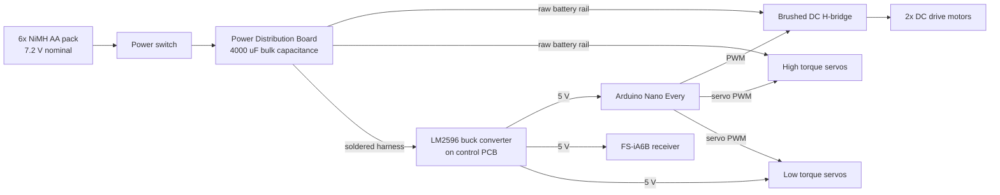

# EWU ASME SDC 2026 Robot

> A remotely controlled garbage truck robot built for the 2026 ASME Student Design Competition, featuring a custom KiCad PCB and power distribution board, Arduino iBUS teleoperation, rear wheel drive with servo steering, a robotic arm, and a rotary dumping bucket. **3rd place overall.**

<p align="center">
  
</p>

> The original written papers (the full ASME SDC report and the battery analysis) are in [`/docs`](/docs). The KiCad PCB files and 3D models are in [`/hardware`](/hardware).

## Table of Contents

- [Overview](#overview)
- [Functionality](#functionality)
  - [Operating Requirements](#operating-requirements)
  - [Drive and Steering](#drive-and-steering)
  - [Manipulation and Dumping](#manipulation-and-dumping)
  - [Radio Control Mapping](#radio-control-mapping)
  - [Input Processing and Failsafe](#input-processing-and-failsafe)
- [System Design](#system-design)
  - [Hardware](#hardware)
  - [Power Architecture](#power-architecture)
  - [Battery Selection Analysis](#battery-selection-analysis)
  - [PCB Design](#pcb-design)
  - [Power Distribution Board](#power-distribution-board)
  - [Software](#software)
  - [Mechanical Design](#mechanical-design)
- [Design Tradeoffs](#design-tradeoffs)
- [Competition Results](#competition-results)
- [Lessons Learned and Future Improvements](#lessons-learned-and-future-improvements)
- [Bill of Materials](#bill-of-materials)
- [Team](#team)
- [AI Disclosure](#ai-disclosure)
- [License](#license)

## Overview

The 2026 ASME SDC challenges teams to design, fabricate, and test a versatile waste collection device that can navigate a model "downtown Dallas", collect and sort garbage and recycling, and dump it into the correct facility (landfill or recycling center) without damaging the playfield or spilling waste.

This robot is a compact, fully teleoperated garbage truck built by the Eastern Washington University ASME chapter. It combines a custom electrical system, Arduino based control logic, a FlySky radio link, a 3D printed PETG chassis, and a servo driven arm that feeds a rotary dumping bucket. It reached the final head-to-head matchup against the top-seeded team and finished **third overall**.

The electrical and control work also served as applied coursework for **EENG 163: Introduction to Embedded Systems** at Eastern Washington University.

## Functionality

### Operating Requirements

The robot had to satisfy the following competition rules:

| Category | Requirement |
|---|---|
| **Size** | Fit inside a 50 cm x 50 cm x 50 cm box, including batteries and tools |
| **Power** | Rechargeable dry cell batteries only, with onboard distribution and no tethering |
| **Control** | Single operator, single radio transmitter |
| **Runs** | 5 to 10 minute timed runs, timer never paused |
| **Repairs** | Battery swaps and wire reconnection allowed on the clock, no soldering or reprogramming |
| **Safety** | No playfield damage, no interference with other robots, unsafe behavior means disqualification |
| **Course** | Navigate 10 to 18 cm wide streets with 90 and 180 degree turns |

### Drive and Steering

| Feature | Behavior |
|---|---|
| **Rear drive** | Two geared yellow DC motors with rubber wheels, driven by a brushed DC H-bridge with forward and reverse PWM |
| **Front steering** | Servo steering through 3D printed control arms, clamped to a safe pulse range |
| **Deadband** | Neutral zone around center throttle prevents unintended motion and drift |
| **Throttle smoothing** | Exponential smoothing reduces jitter and drivetrain current spikes |

### Manipulation and Dumping

| Feature | Behavior |
|---|---|
| **Arm** | Servo driven arm with gripper and shoulder joint, designed by David Alvarado |
| **Shoulder motion** | Stepped slowly toward its target angle for smooth, controlled movement |
| **Arm to dumper slide** | At a 35 degree arm angle, nearly any material slides from the small receptacle into the dumper |
| **Rotary dumper** | Servo tips the bucket with analog control so contents slide out smoothly into the large receptacle |

### Radio Control Mapping

| Channel | Function | Pin |
|---|---|---|
| CH1 | Steering servo | D2 |
| CH2 | Drive motor throttle (FWD / REV) | D9 / D10 |
| CH3 | Auxiliary servo | D4 |
| CH5 | Gripper servo | D3 |
| CH6 | Shoulder servo | D5 |

> Mapping is taken from the firmware v10.0.0 listing. Confirm against your sketch before publishing.

### Input Processing and Failsafe

- **iBUS decoding:** frames from the FlySky FS-iA6B are read on hardware serial and parsed in software
- **Checksum validation:** corrupted frames are discarded
- **Normalization:** channel values map to roughly 1000 to 2000 µs pulse widths, then to actuator specific ranges
- **Failsafe:** the receiver returns outputs to neutral on signal loss, which stops the motors

## System Design

### Hardware

| Component | Details |
|---|---|
| Microcontroller | Arduino Nano Every |
| Radio | FlySky FS-iA6B receiver (iBUS serial) with FlySky transmitter |
| Battery | 6x NiMH AA in series, 7.2 V nominal |
| Regulation | LM2596 buck converter module, 5 V logic rail |
| Motor driver | Brushed DC H-bridge |
| Drive motors | 2x geared yellow DC motors |
| Servos | SG90 and MG995 types (see BOM) |
| Capacitance | 4x 1000 µF electrolytic (4000 µF bulk) |
| Structure | 3D printed PETG |

### Power Architecture

The design separates power into two domains so motor noise cannot reset the microcontroller.



- Unregulated battery voltage feeds the motor driver and high torque servos directly, avoiding current limits and voltage drops from a regulator
- 4000 µF of bulk capacitance absorbs transients from motor acceleration and steering
- Regulation is reserved for logic level components only

### Battery Selection Analysis

Pack selection came from an EENG 163 research project (February 2026). Each pack is modeled as an ideal source with internal resistance:

$$V_{load} = V_{nominal} - I_{draw} \cdot R_{internal}$$

Targets were a **2 A** worst case load and a **6 V** minimum so the buck converter could hold a stable 5 V.

| Parameter | Alkaline 9 V | Alkaline AA | NiMH AA |
|---|---|---|---|
| Nominal voltage per cell | 9 V | 1.5 V | 1.2 V |
| Internal resistance per cell | 1.5 Ω | 0.15 Ω | 0.02 Ω |
| Max continuous current | 0.1 A | 1 A | 3 A |
| Tested pack | 1 cell | 6 in series | 6 in series |
| Pack voltage / resistance | 9 V / 1.5 Ω | 9.0 V / 0.9 Ω | 7.2 V / 0.12 Ω |
| Voltage at 2 A | 6 V | 7.2 V | 6.96 V |
| Verdict | Unsafe, 20x over rating | Over 1 A rating | Safe, most robust |

$$\text{NiMH AA (6S): } V_{load} = 7.2 - 2(0.12) = 6.96\ \text{V}$$

<p align="center">
  
</p>

> The analysis assumed a brushless motor. The final robot used low draw yellow DC motors instead, so the NiMH pack ran with extra margin.

### PCB Design

Designed in KiCad and fabricated through JLCPCB. All project files are in [`/hardware/KiCAD PCB`](</hardware/KiCAD PCB>).

- LM2596 buck converter footprint for the 5 V rail
- Arduino Nano Every mounted directly on the board
- Five male pin header interfaces plus separated ground and power rails in a 5x3 layout, usable with Dupont connectors or direct soldering
- Continuous ground plane to reduce noise coupling between motor circuits and logic


### Power Distribution Board

- Four 1000 µF capacitors across the main rail
- Integrated brushed DC H-bridge for the drive motors
- Physical power switch for fast shutdown during setup and repairs
- Three 3 pin headers supplying raw battery voltage to high torque servos, with control signals routed separately from the control PCB
- Joined to the control PCB by two soldered wire harnesses for vibration resistance

### Software

Arduino sketch (version 10.0.0) running on the Nano Every, adapted from SwapnilNimbalkar's iBUS to PWM receiver tutorial. The full listing is also in the appendix of the report in [`/docs`](/docs).

**Dependencies:** `Servo`

```
firmware/    # Arduino iBUS teleoperation sketch (.ino)
```


### Mechanical Design

*Written by Zachary Jump, with arm and dumper integration by David Alvarado. CAD files are in [`/hardware/3D Models`](</hardware/3D Models>).*

#### Chassis

The chassis went through several overhauls. It began as an RC car style layout with systems mounted separately, then flipped to building the chassis around the components once subsystem designs matured. PLA was dropped for **PETG** because PLA snapped before flexing, while PETG deforms instead of fracturing.

<table>
  <tr>
    <td align="center" width="50%">
      <br>
      <em>Initial lower chassis</em>
    </td>
    <td align="center" width="50%">
      <br>
      <em>Initial full assembly</em>
    </td>
  </tr>
  <tr>
    <td align="center" width="50%">
      <br>
      <em>Chassis overhaul V3</em>
    </td>
    <td align="center" width="50%">
      <br>
      <em>Final chassis gallery</em>
    </td>
  </tr>
</table>

#### Drivetrain and Steering

Four Mecanum wheels were the first idea, but programming effort and the need for flat smooth terrain ruled them out. The final layout is rear wheel drive with servo steered front wheels.

| Steering Property | Value |
|---|---|
| Geometric maximum angle | 53 degrees (control arms go parallel and steering locks) |
| Achieved maximum angle | 32 degrees (limited by clearance around thick printed parts) |
| Servo advantage | Greatest at 0 degrees, approaches zero near 53 degrees |

<table>
  <tr>
    <td align="center" width="50%">
      <br>
      <em>Steering, front view</em>
    </td>
    <td align="center" width="50%">
      <br>
      <em>Steering, top down</em>
    </td>
  </tr>
  <tr>
    <td align="center" width="50%">
      <br>
      <em>Abandoned brushless drivetrain</em>
    </td>
    <td align="center" width="50%">
      <br>
      <em>Final yellow DC motors</em>
    </td>
  </tr>
</table>

The first rear drive used a brushless motor with a planetary gearbox, driveshaft, and bevel gears, but it drew far too much current from the pack. The two yellow DC motors draw little power, deliver the needed torque, and came with their own wheels.

#### Rotary Dumping Mechanism

The dumper sits high on the robot, which frees room underneath for electronics and drivetrain parts. A slide between the arm and the bucket guides material from the small receptacle into the dumper, and a rear mounted servo tips the bucket on a plastic pivot to dump into the large receptacle.

<table>
  <tr>
    <td align="center" width="50%">
      <br>
      <em>Dumper, top view</em>
    </td>
    <td align="center" width="50%">
      <br>
      <em>Arm slide and gear detail</em>
    </td>
  </tr>
  <tr>
    <td align="center" width="50%">
      <br>
      <em>Pivot and servo mount</em>
    </td>
    <td align="center" width="50%">
      <br>
      <em>Bucket on its own</em>
    </td>
  </tr>
</table>

## Design Tradeoffs

| Decision | Reasoning |
|---|---|
| **NiMH over LiPo** | LiPo has higher energy density but raises classification and handling concerns. NiMH is robust, widely available, meets the dry cell rule, and the AA form factor simplifies swaps |
| **Arduino over a faster MCU** | Teleoperation needs no heavy computation. Arduino kept development and debugging fast |
| **Custom PCB** | Fewer loose connections, better vibration resistance, faster troubleshooting |
| **Battery voltage to high current loads** | Avoids regulator current limits and voltage drops. Regulation reserved for logic |
| **Servo steering over Mecanum** | Simple and fast to build, at the cost of a marginal turning radius |
| **PETG over PLA** | Slightly less stiff, but bends instead of breaking |

## Competition Results

The robot completed one Initial Testing Demonstration and three Head-to-Head Elimination rounds, advanced through the bracket, and met the top-seeded team in the final matchup, finishing **third overall**.

| Observation | Outcome |
|---|---|
| NiMH pack and bulk capacitance | Reliable power with no resets, best when fully charged before each run |
| Dupont connector failures in round one | Critical connections were soldered afterward |
| Sawdust-like debris on the field | Reduced wheel traction under acceleration and turning |
| Marginal turning radius | Lots of pivoting at 90 and 180 degree corners |
| Right side arm placement | Limited approach angles to some bins |

Overall, the limits were mechanical (traction, steering geometry, subsystem placement), not electrical.

## Lessons Learned and Future Improvements

**Lessons**

- Build the chassis around the components instead of fitting components into a chassis
- Separate actuator power from logic power early
- Solder or lock every critical connection from the start
- Match the motor to the pack's internal resistance

**Future improvements**

- Larger steering angle, or a differential drive layout for tighter pivoting
- More aggressive or softer tread, and a debris clearing feature
- Arm mounted closer to the centerline
- Inline fuse and reverse polarity protection at the battery input, and servo supply voltage checked against datasheet limits at full charge
- Firmware frame timeout so motors stop even if the receiver holds its last values, plus verified receiver failsafe
- Full power budget with measured voltage under load, and a BOM kept current as parts are added

## Bill of Materials

| Item | Qty | Unit | Total |
|---|---|---|---|
| Arduino Nano Every | 1 | $18.00 | $18.00 |
| FS-iA6B/X TX/RX | 1 | $45.00 | $45.00 |
| Geared DC Motor | 2 | $1.00 | $2.00 |
| AA Battery Cage | 1 | $8.00 | $8.00 |
| Servo (SG90) | 1 | $2.00 | $2.00 |
| Servo (MG995) | 2 | $4.50 | $9.00 |
| PCB | 1 | - | $5.00 |
| PDB | 1 | - | $2.00 |
| Misc. Wires | - | - | $2.00 |
| 3D Printed Parts | - | - | $4.00 |
| **Grand Total** | | | **$97.00** |

> - Costs are taken from the written report's BOM.
> - The NiMH cells, LM2596 module, capacitors, and H-bridge are not itemized in the original table.

## Team

**Seth A. Hibpshman**  
Student of Electrical and Computer Engineering, Eastern Washington University  
Electrical system, custom PCB, power distribution board, battery analysis, firmware

**Zachary Jump**  
Student of Mechanical Engineering, Eastern Washington University  
Chassis, drivetrain, steering, rotary dumping mechanism

**David Alvarado**  
Student of Mechanical Engineering, Eastern Washington University  
Robotic arm

American Society of Mechanical Engineers, Eastern Washington University Chapter.

## AI Disclosure
_AI (LLM) tools were used in the drafting and editing of this README; the project design, hardware, and firmware are the team's own work._

## License

[LICENSE](LICENSE)
